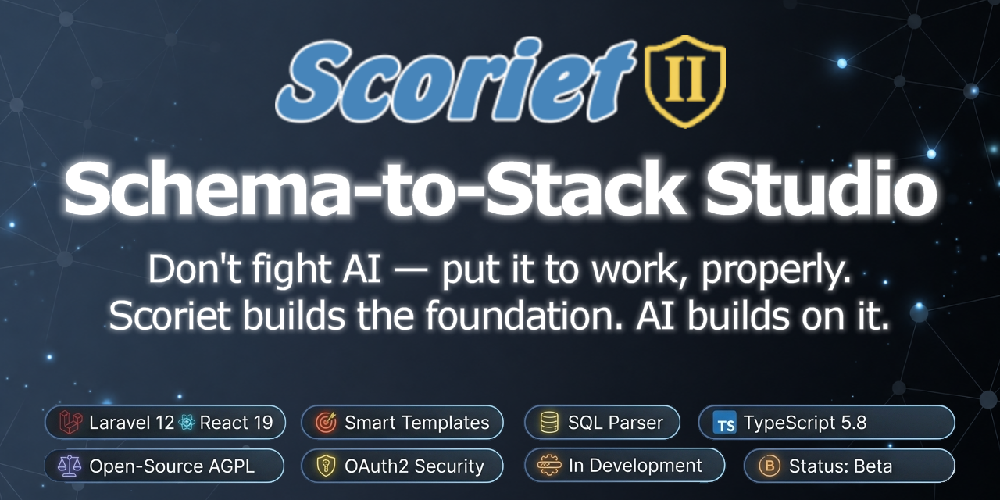
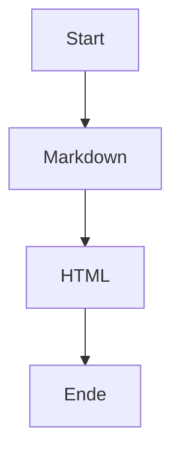

# Markdown Feature Test

<div align="center">

# Scoriet V 1.0.0.5 Latest Changes from 7.6.2026

</div>



<div align="center">

[](https://laravel.com)
[](https://reactjs.org)
[](https://www.typescriptlang.org)
[](https://inertiajs.com)


[](https://www.gnu.org/licenses/agpl-3.0)
[](https://github.com/harveyhase68/scoriet)

</div>

<div align="center">

[**🧪 Live Demo**](https://demo.scoriet.dev) • [\*\* Application\*\*](https://scoriet.dev) • [**📋 Installation**](INSTALLATION.md) • [**Documentation**](https://scoriet.com/docs/) • [**Contributing**](#contributing)

</div>

```bash
# 🚀 All-in-one development server (recommended)
# Runs Laravel server + queue worker + Vite dev server
composer run dev

# 🔥 With Server-Side Rendering
composer run dev:ssr

# ⚙️ Manual start (for debugging)
php artisan serve --host=10.0.0.8 --port=8000  # Backend
php artisan queue:listen --tries=1              # Queue worker
npm run dev                                       # Frontend
```

## Superscript

E = mc^2^

## Subscript

H~2~O

CO~2~

## Highlight

==This text **should** be highlight!==

## Footnotes

Markdown is a markup language.[^1]

[^1]: Dies ist eine Fußnote.

## Custom ID

# Installation {#installation}

[Zur Installation springen](#installation)

## Definition List

Markdown
: A lightweight markup language.

HTML
: Hypertext Markup Language.

## Syntax Highlighting

```javascript
function hello() {
    console.log("Hello World!");
}
```

```python
def hello():
    print("Hello World!")
```

## Mermaid



## Math

Inline: $E = mc^2$

$$
E = mc^2
$$


$$
\frac{-b \pm \sqrt{b^2 - 4ac}}{2a}
$$

<div align="center">

| Aspect | Configuration | Type |
|---|---|---|
| Web server | Apache + PHP 8.4 (production-style) | prod-like |
| Frontend | `vite build --mode docker` → static `public/build` | prod-like |
| Composer | `--no-dev --optimize-autoloader` | prod-like |
| `APP_ENV` | `local` | dev |
| `APP_DEBUG` | `true` (full stacktraces in browser) | dev |
| `LOG_LEVEL` | `debug` | dev |
| OAuth secret | hardcoded in image (development-only value) | dev |
| Frontend rebuild | every container start (slow first start, instant DB visibility) | hybrid |

</div>

